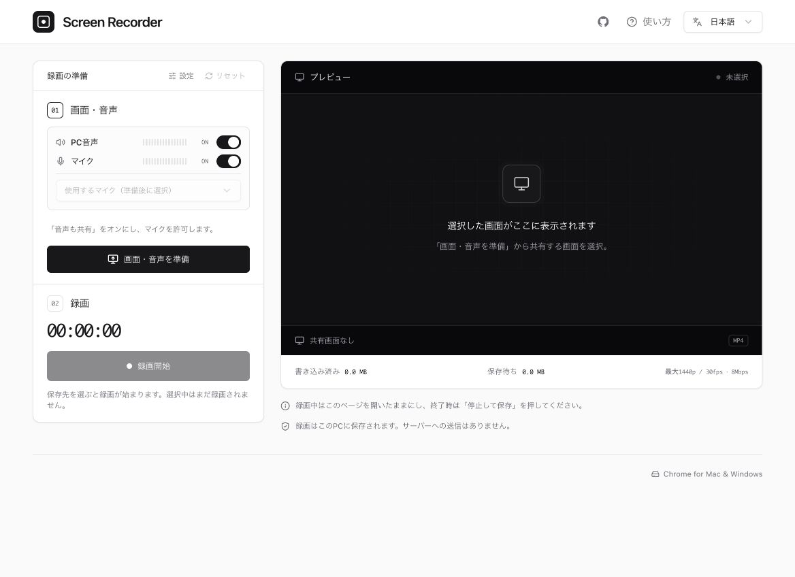

# Screen Recorder

[English](README.md) · 日本語

ブラウザで画面と音声を録画し、MP4・WebMでPCに直接保存できる無料のアプリです。インストール・登録不要。**録画データはPC内に保存され、サーバーにアップロードされません。**

**[Screen Recorderを開く](https://screen-recorder.ysk.im/ja/)**



## 特徴

- ブラウザのタブ・ウィンドウ・画面全体を録画。
- PC音声とマイクの録音を、それぞれ個別にON/OFF。
- MP4・WebMで保存。解像度・フレームレート・映像と音声のビットレートを調整可能。
- 録画データを順次ローカルファイルに書き込み、動画全体をメモリに蓄積しない仕組み。
- 日本語・英語に対応。選択した言語・録画品質・音声設定をブラウザに記憶。

## 使い方

録画品質や保存形式を変えたい場合は、最初に「設定」で変更します。

1. **画面・音声を準備** — 録音する音声を選び、共有する画面を指定します。PC音声を録音する場合はChromeの共有画面で音声共有を有効にし、マイクを使う場合はアクセスを許可します。
2. **録画開始** — 音声メーターを確認し、PC内のファイル名と保存先を選びます。確定すると自動で録画が始まります。選択中はまだ録画されず、キャンセルしても画面・音声の準備は維持されます。
3. **停止して保存** — 「録画を保存しました」と表示されるまでページを開いておきます。動画は選択したフォルダーで確認できます。

## 対応環境・注意点

- Mac・Windowsの最新版デスクトップGoogle Chromeをご利用ください。画面の取得とローカルファイルへのアクセスには、HTTPSまたはlocalhostが必要です。
- PC音声の取得範囲はOSと共有対象に依存します。取得できない場合は、Chromeのタブを音声共有付きで選んでください。
- マイクの録音は、会議アプリのミュートとは独立しています。このアプリのマイクがONなら、会議側でミュートしていても録音されます。
- 録画中はページを開いたままにし、PCをスリープさせないでください。終了時は停止して保存完了まで待ってください。ページを閉じた場合やクラッシュからの復旧には対応していません。

## 開発

TypeScript・React・Vite・shadcn/ui・Tailwind CSSを使用しています。バックエンドを持たず、ブラウザ内で動作します。テストはVitestとReact Testing Libraryを使用します。

Node.js 24とnpmを使用してください。

```sh
npm ci
npm run dev
```

ターミナルに表示されるlocalhostのURLを開いてください。

```sh
npm run check   # 型チェック、lint、テスト、フォーマット確認
npm run format  # ソースファイルのフォーマット
npm run build   # dist/ に静的ファイルを生成
npm run preview # 本番ビルドをローカルで確認
```

ビルド時に`/`・`/en/`・`/ja/`の静的ページを生成します。GitHub Pagesと独自ドメインの設定は[公開手順（英語）](docs/DEPLOYMENT.md)を参照してください。

## ライセンス

[MIT](LICENSE)
