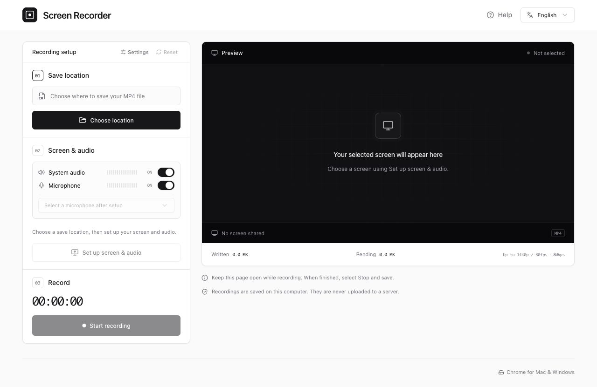

# Screen Recorder

English · [日本語](README.ja.md)

A free browser app to record your screen and audio, then save MP4 or WebM directly to your computer. No installation or sign-up required. **Recordings stay on your computer and are never uploaded.**

**[Open Screen Recorder](https://screen-recorder.ysk.im/en/)**



## Features

- Record a browser tab, window, or entire screen.
- Turn system audio and microphone recording on or off independently.
- Save as MP4 or WebM, with adjustable resolution, frame rate, and video/audio bitrates.
- Write recording data to a local file as it arrives, without keeping the entire video in memory.
- Switch between English and Japanese. Language, recording quality, and audio preferences are remembered in your browser.

## Usage

Adjust **Settings** first if you want to change the recording quality or file format.

1. **Choose location** — Pick a filename and folder on your computer.
2. **Set up screen & audio** — Choose which audio sources to record, then select a screen. Enable audio sharing in Chrome’s picker for system audio, and allow microphone access if needed.
3. **Start recording** — Check the audio meters, then start.
4. **Stop and save** — Keep the page open until **Recording saved** appears. Find the video in the folder you chose.

## Requirements & Notes

- Use the latest desktop Google Chrome on Mac or Windows. Screen capture and local file access require HTTPS or localhost.
- System audio availability depends on your OS and what you share. If it is unavailable, try sharing a Chrome tab with audio enabled.
- Microphone recording is independent of your meeting app’s mute button. If the microphone is on here, it continues recording even when you are muted in the meeting.
- Keep the page open and your computer awake while recording. Always stop and wait for saving to finish; recovery after closing the page or a crash is not supported.

## Development

Built with TypeScript, React, Vite, shadcn/ui, and Tailwind CSS. Runs entirely in the browser with no backend. Tests use Vitest and React Testing Library.

Use Node.js 24 and npm.

```sh
npm ci
npm run dev
```

Open the localhost URL printed in the terminal.

```sh
npm run check   # Type checking, lint, tests, and formatting checks
npm run format  # Format the source files
npm run build   # Generate static files in dist/
npm run preview # Preview the production build locally
```

The build generates `/`, `/en/`, and `/ja/` as static pages. See the [deployment guide](docs/DEPLOYMENT.md) for GitHub Pages and custom domain setup.

## License

[MIT](LICENSE)
